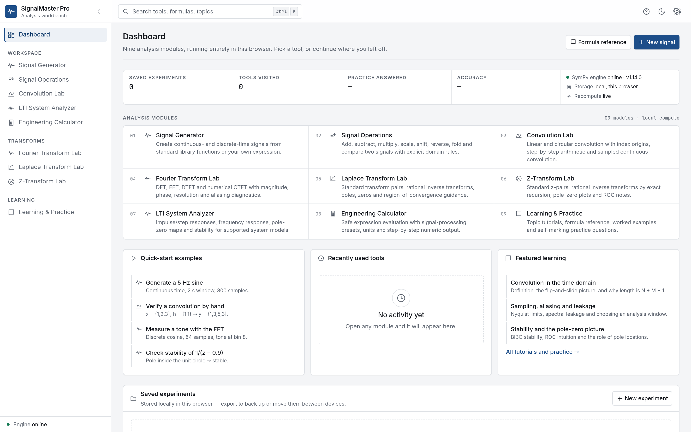
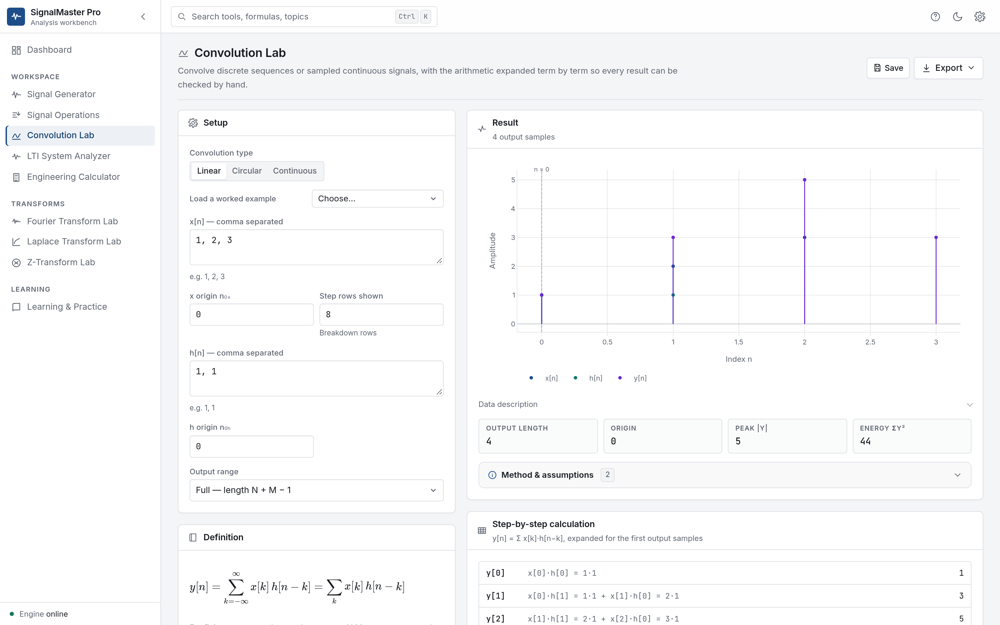
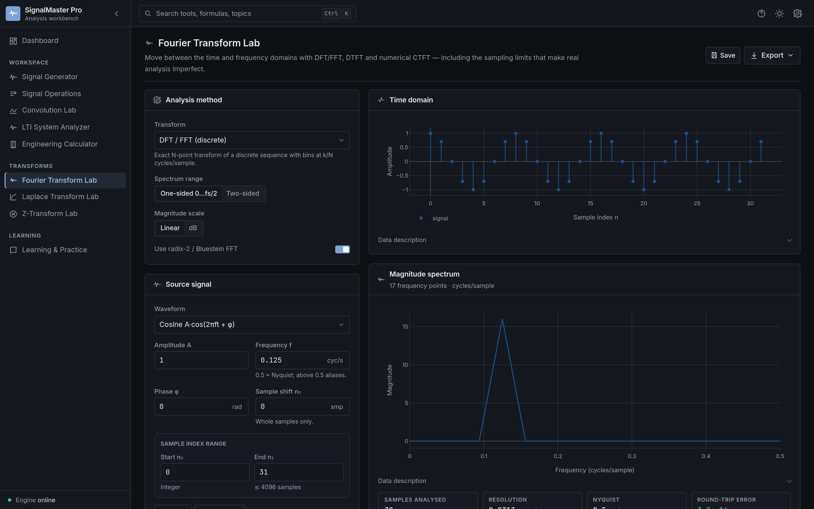
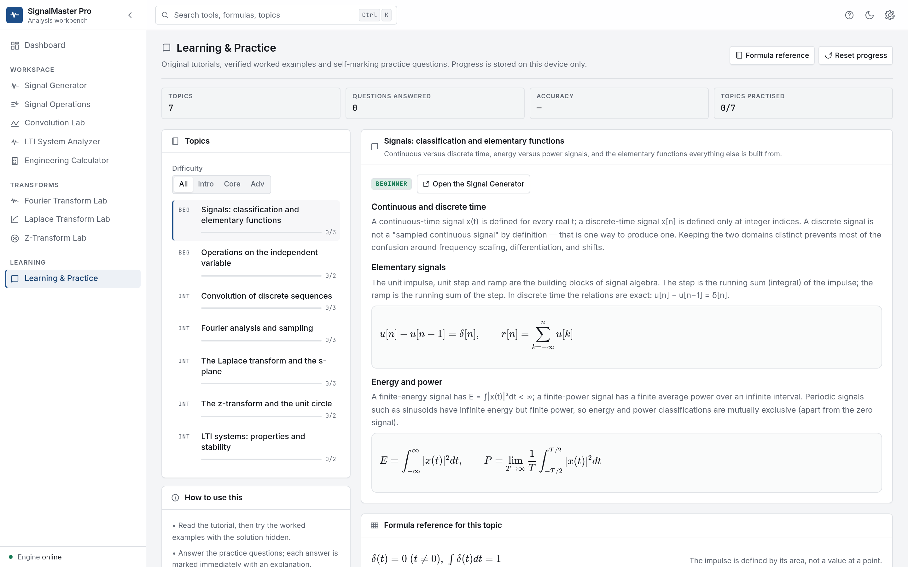

# SignalMaster Pro

**Understand Signals. Analyze Systems. Master Engineering.**

An open-source workbench for signal processing and systems engineering. Generate and combine signals,
convolve sequences, compute Fourier/Laplace/Z transforms, analyse LTI systems, and practise the
mathematics behind each operation — with the assumptions stated next to every result.

- No account, no tracking, no paid services.
- All numerical work runs **locally in your browser**; saved experiments stay on your device.
- An **optional** Python/SymPy service adds symbolic transforms. The app is fully usable without it.



*Dashboard, light theme. Counts are read from what is actually stored in this browser.*

| Convolution Lab | Fourier Transform Lab (dark) |
| --- | --- |
|  |  |



The visual language is documented in **[docs/design-system.md](docs/design-system.md)**: one accent colour,
hairline borders instead of drop shadows, a compact 13.5 px type scale, tabular numerals for every value, and
self-hosted Inter / JetBrains Mono (SIL OFL) so typography never depends on a CDN.

---

## 1. Feature summary

| Module | What it does |
| --- | --- |
| **Dashboard** | Live counts of saved experiments, visited tools and practice progress; quick-start examples; experiment management (rename / duplicate / load / delete / export / import). |
| **Signal Generator** | Unit impulse, step, ramp, exponential, sine, cosine, rectangular and triangular pulses, and custom expressions. Continuous-time (uniform sample grid) and discrete-time (integer indices) rendering with stem plots, formulas, statistics and CSV/JSON/PNG export. |
| **Signal Operations** | Addition, subtraction, multiplication, comparison, amplitude scaling, time shift, time reversal/folding and time scaling, with explicit domain alignment, interpolation and out-of-support policies. |
| **Convolution Lab** | Linear (full/same/valid), circular (mod N) and numerical continuous-time convolution, with index origins, output alignment, term-by-term step tables and CSV export. |
| **Fourier Transform Lab** | DFT (direct) and FFT (radix-2 + Bluestein), DTFT sweep and numerical CTFT; magnitude (linear/dB) and phase plots, bin tables, resolution/Nyquist/reconstruction diagnostics and aliasing guidance. |
| **Laplace Transform Lab** | 12 documented transform pairs, rational F(s) → f(t) via a verified partial-fraction expansion, pole/zero tables, ROC and stability notes, optional SymPy forward/inverse transforms. |
| **Z-Transform Lab** | Documented z-pairs, rational X(z) → x[n] by exact recursion, cross-checked closed forms, z-plane pole/zero map and stability/ROC notes. |
| **LTI System Analyzer** | Difference equations and rational H(s): impulse/step responses, frequency response, pole–zero maps, BIBO stability and a property report that states the model assumptions. |
| **Engineering Calculator** | Safe expression evaluator with a fixed function set, signal-processing presets, units, exact-vs-approximate labelling and step-by-step output. |
| **Learning & Practice** | 7 topics, worked examples with verified answers, self-marking multiple-choice questions with explanations, local progress tracking, plus a searchable formula reference. |

Cross-cutting: light/dark themes, command palette (`Ctrl/⌘+K`), contextual help (`Ctrl/⌘+/`), settings,
keyboard navigation, responsive layout down to 390 px, accessible charts with text alternatives, CSV /
JSON / PNG / print export, and printable views.

---

## 2. Technology stack

| Layer | Choice | Why |
| --- | --- | --- |
| UI | React 18 + TypeScript 5 (strict) + Vite 5 | Fast builds, strong typing for numerical code. |
| Styling | Tailwind CSS 3 with CSS-variable design tokens | A single token set drives both themes. |
| Charts | Plotly.js (basic bundle) | Interactive zoom/pan and reliable PNG export. |
| Math | KaTeX | Fast, accessible LaTeX rendering. |
| Numerics | Hand-written TypeScript modules (`src/core`) — FFT, convolution, roots, partial fractions, rational analysis | No server round-trip, deterministic, and unit-testable in isolation. |
| Optional backend | FastAPI + SymPy | Symbolic transforms only; isolated-process execution with a timeout. |
| Storage | `localStorage` | Saved experiments and preferences need no server. |
| Tests | Vitest + React Testing Library (unit/component), Pytest (backend), Playwright (E2E) | |

**No database is used** because nothing needs multi-user or cross-device persistence. Saved experiments are
local JSON blobs; export/import covers backup and transfer.

---

## 3. Repository layout

```
signalmaster-pro/
├── frontend/
│   ├── e2e/critical-flows.spec.ts        # Playwright journeys (desktop + mobile)
│   ├── src/
│   │   ├── app/                          # shell, routing, registry, dialogs, error boundary
│   │   ├── components/                   # ui primitives, plot wrapper, shared widgets
│   │   ├── core/                         # numerics (no React imports)
│   │   │   ├── complex.ts fft.ts dsp.ts poly.ts rational.ts
│   │   │   ├── signals.ts operations.ts convolution.ts fourier.ts
│   │   │   ├── laplace.ts ztransform.ts systems.ts expr.ts validation.ts
│   │   ├── features/                     # one folder per module
│   │   ├── hooks/ services/ styles/ types/
│   │   └── tests/                        # vitest unit + component tests
│   ├── index.html  vite.config.ts  tailwind.config.js  tsconfig.json
│   ├── .eslintrc.cjs  .prettierrc.json  playwright.config.ts
│   └── package.json  package-lock.json
├── backend/
│   ├── app/
│   │   ├── api/routes.py  core/{config,security}.py
│   │   ├── schemas/symbolic.py  services/symbolic_engine.py
│   │   ├── tests/test_api.py  main.py
│   ├── requirements.txt  requirements-dev.txt  pyproject.toml
├── docs/            architecture, conventions, security, testing, deployment, troubleshooting
├── scripts/         dev.sh, check.sh
├── .github/workflows/ci.yml
├── README.md  CONTRIBUTING.md  LICENSE  .gitignore
```

The numerical core (`frontend/src/core`) has **no UI imports**, so every formula can be tested directly in
Node — that is what the 84 unit tests do.

---

## 4. Installation and running

### Prerequisites
- Node.js **18.18+** (tested on 20.20) and npm 9+
- Python **3.11+** (tested on 3.13) — only if you want the optional symbolic engine

### Frontend (required)

```bash
cd frontend
npm install
npm run dev          # http://localhost:5173
```

Production build:

```bash
npm run build        # type-checks, then emits frontend/dist
npm run preview      # serves dist at http://localhost:4173
```

**Single-file build (no server at all):** `npm run build:standalone` emits one self-contained
`frontend/dist-standalone/index.html` with JS, CSS, fonts and charts inlined, using hash routing. It opens
straight from a `file://` URL — useful for offline demos and for environments where only a static file can be
shared. The symbolic engine is unavailable in that mode; the app reports it as offline.

### Optional symbolic backend

```bash
cd backend
python -m venv .venv && source .venv/bin/activate      # Windows: .venv\Scripts\activate
pip install -r requirements.txt                        # add -r requirements-dev.txt for tests
uvicorn app.main:app --reload --port 8000              # http://localhost:8000/api/docs
```

During development the Vite server proxies `/api` to `http://127.0.0.1:8000`, so no CORS setup is needed.
The sidebar shows **“Symbolic engine online/offline”**; when offline, every numeric module keeps working and
only the symbolic panels explain that the service is not running.

### Environment variables

| Variable | Default | Purpose |
| --- | --- | --- |
| `VITE_API_BASE` | `''` (same origin) | Base URL of the API when the frontend is served from a different origin. |
| `SMP_ALLOWED_ORIGINS` | localhost 5173/4173 | Comma-separated CORS allow-list. **Set this in production.** |
| `SMP_MAX_BODY_BYTES` | `8192` | Maximum request body size. |
| `SMP_MAX_EXPRESSION_LENGTH` | `300` | Maximum characters in an expression. |
| `SMP_COMPUTE_TIMEOUT_SECONDS` | `6` | Wall-clock budget per symbolic computation (enforced in a child process). |
| `SMP_RATE_LIMIT_PER_MINUTE` | `30` | Per-client request budget (single process). |
| `SMP_FRONTEND_DIST` | `signalmaster-pro/frontend/dist` | Directory served as the SPA when present. |
| `SMP_ENABLE_DOCS` | `true` | Enables `/api/docs`; set `false` to hide the schema. |
| `SMP_LOG_LEVEL` | `info` | Uvicorn/logging level. |
| `PW_CHROMIUM` | unset | Path to an existing Chromium binary for Playwright (CI images that preinstall it). |

No secrets are required. **Do not commit `.env` files** containing deployment values.

---

## 5. Testing

```bash
cd frontend
npm test              # Vitest: 104 unit + component tests
npm run typecheck     # tsc --noEmit (strict)
npm run lint          # ESLint
npm run build         # production build
```

```bash
cd backend
pip install -r requirements-dev.txt
python -m pytest -q   # 36 API/safety tests
```

End-to-end (needs browser binaries: `npx playwright install chromium`):

```bash
cd frontend
npx playwright test                 # desktop + mobile projects
```

`scripts/check.sh` runs typecheck, lint, unit tests and the production build in one go.

See **[docs/testing.md](docs/testing.md)** for the current results and what is *not* covered.

---

## 6. Deployment

### Option A — static hosting (frontend only)
`npm run build` produces a self-contained `frontend/dist`. Serve it from any static host. Because the app
uses client-side routing, configure an SPA fallback (rewrite unknown paths to `index.html`):

- **Netlify**: `/* /index.html 200` in `_redirects`
- **Vercel**: rewrite `/(.*)` → `/index.html`
- **nginx**: `try_files $uri $uri/ /index.html;`
- **GitHub Pages**: copy `dist/index.html` to `dist/404.html`

Nothing else is required: all calculations run client-side.

### Option B — single origin with the symbolic engine
Build the frontend, then start the API; it serves `frontend/dist` and the API from one origin:

```bash
cd frontend && npm run build
cd ../backend && SMP_ALLOWED_ORIGINS=https://your-domain.example SMP_ENABLE_DOCS=false \
  uvicorn app.main:app --host 0.0.0.0 --port 8000
```

Put it behind a TLS-terminating reverse proxy and set `SMP_ALLOWED_ORIGINS` to your real origin.

### Option C — Render (one click, frontend + engine)

[](https://render.com/deploy?repo=https://github.com/AkshayTrivediINDIA/signalmaster-pro)

`render.yaml` defines a single Docker web service: stage 1 builds the SPA with `npm ci && npm run build`, stage 2
runs FastAPI/SymPy and serves that build from the same origin, so there is no CORS setup and no `VITE_API_BASE`
to keep in sync. `GET /api/health` is the health check.

Free instances sleep after inactivity, so the first request after a quiet period takes roughly a minute. A
symbolic computation runs in a child process; if the instance runs out of memory, move the service to a larger
plan (see “Memory” above).

### Cost note
The software itself is free and open source, and it needs no paid services. Whether hosting is free depends
on the provider you choose — free tiers change, and custom domains usually cost money. This project makes no
promise that hosting will remain free.

---

## 7. Scientific conventions (short version)

Full detail: **[docs/scientific-conventions.md](docs/scientific-conventions.md)**.

- DFT: `X[k] = Σ x[n]e^{-j2πkn/N}` with inverse scaled by `1/N`; bin `k` ↔ `f = k·fs/N`.
- Continuous time uses Hz; discrete time uses cycles/sample (Nyquist = 0.5).
- `u(0) = 1` (right-continuous); `sinc(x) = sin(πx)/(πx)` with `sinc(0) = 1`.
- Polynomial coefficients (s and z) are entered **highest power first**: `s² + 3s + 2 → 1, 3, 2`.
- Laplace and Z inverses are **causal** (right-sided); the ROC is stated with each result.
- Continuous-time convolution, CTFT and the sampled spectrum are **numerical approximations**; each result
  reports its grid, step size and the resulting resolution.
- Ideal impulses cannot be plotted as finite values: they are drawn as unit-area stems.

---

## 8. Known limitations

- **Continuous-time results are sampled renderings.** CT convolution/CTFT are rectangle-rule approximations
  with `O(Δt)` error for discontinuous signals; the UI reports `Δt`.
- **Non-rational transforms are reference-only.** Expressions containing `e^{−sT}` (delayed steps, pulses)
  are listed as pairs but not factored into poles/zeros.
- **Two-sided (non-causal) inverses are not provided.** Only causal/right-sided inverses are computed.
- **The symbolic engine covers a documented subset.** Unsupported expressions return an explicit error; no
  result is invented. The backend is single-process with an in-memory rate limiter — put a shared limiter at
  the proxy for multi-instance deployments.
- **Z-transform analysis is limited to rational transforms** of modest degree (roots are found iteratively,
  verified by residual, and the degree is capped).
- **No cloud sync or accounts.** Experiments live in one browser profile; use export/import to move them.
- **No PDF export.** Print to PDF from the printable view instead; PNG export covers plots only.
- **Playwright downloads browsers on first use** (~150 MB); it is not part of `npm test`.

---

## 9. License

Released under the **MIT License** — see [LICENSE](LICENSE). Third-party licenses:

| Dependency | License |
| --- | --- |
| React, React DOM, React Router | MIT |
| Vite, TypeScript, Tailwind CSS, Vitest, Playwright | MIT / Apache-2.0 |
| Plotly.js | MIT |
| KaTeX | MIT |
| Inter, JetBrains Mono (self-hosted `src/assets/fonts`) | SIL OFL 1.1 |
| FastAPI, Uvicorn, Pydantic | MIT |
| NumPy / SymPy (backend) | BSD-3-Clause |

Educational tool: verify critical results independently. Not affiliated with any examining body.
